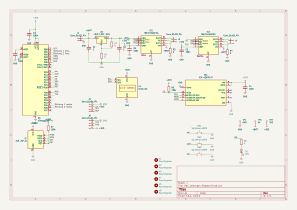
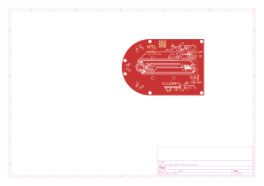

# HWE – Roboter

Felix Mähr und Linus Kimpfler · Hardwareentwicklung · Stand: 22. Oktober 2026

> Hardware-Zwischenstand vor der geplanten PCB-Bestellung. Schaltplan und Layout sind nach Angabe der Projektgruppe erstellt. Das Projekt ist noch nicht abgeschlossen; Fertigung, Bestückung und Funktionsprüfung sind nicht als abgeschlossen dokumentiert.

Eine eigene Steuerplatine für einen kleinen Roboter mit zwei unabhängig ansteuerbaren DC-Motoren: ATmega328P, zwei Motortreiber, BMI323 als vorgesehenem Bewegungssensor, drei Tastern und einem I²C-OLED.

[Schaltplan](#schaltplan) · [PCB](#leiterplatte) · [Pinbelegung](#pinbelegung) · [HTML-BOM](HWE_Uebungen_Roboter/bom/ibom.html) · [Offene Punkte](#offene-punkte)

## Inhaltsverzeichnis

1. [Projektstand und Grundlagen](#projektstand-und-grundlagen)
2. [Dateien und Projekt öffnen](#dateien-und-projekt-öffnen)
3. [Schaltplan](#schaltplan)
4. [Hardware und Versorgung](#hardware-und-versorgung)
5. [Pinbelegung](#pinbelegung)
6. [Leiterplatte](#leiterplatte)
7. [Stückliste und Bestückungshilfe](#stückliste-und-bestückungshilfe)
8. [Offene Punkte](#offene-punkte)
9. [Versionsverwaltung und nächste Projektphase](#versionsverwaltung-und-nächste-projektphase)
10. [Technische Unterlagen](#technische-unterlagen)

## Projektstand und Grundlagen

Diese Dokumentation beschreibt den Hardwareentwurf, nicht einen bereits funktionsgeprüften Roboter. Firmware und Programmierung folgen in einer späteren Projektphase und sind hier nicht enthalten. Fahrfunktion, Displayausgabe und Sensorkommunikation sind nicht als getestet dokumentiert.

Grundlagen sind die bereitgestellten KiCad-Dateien, die Repository-Unterlagen, die Angaben der Projektgruppe und die [Semiversus-Aufgabenstellung](https://www.semiversus.com/hwe/teil1_und_teil2/uebersicht.html). Die detaillierten Anschlussangaben wurden aus dem hochgeladenen KiCad-Zwischenstand abgeleitet. Nach Änderungen müssen Tabellen, Abbildungen und HTML-BOM erneut abgeglichen werden. Ein vollständiger ERC-/DRC-Lauf wurde bei der Erstellung dieser Dokumentation nicht ausgeführt.

## Dateien und Projekt öffnen

| Pfad | Inhalt |
| --- | --- |
| `Datasheets/` | Herstellerdatenblätter |
| `HWE_Uebungen_Roboter/HWE_Uebungen_Roboter.kicad_pro` | KiCad-Projekt und Entwurfsregeln |
| `HWE_Uebungen_Roboter/HWE_Uebungen_Roboter.kicad_sch` | Editierbarer Schaltplan |
| `HWE_Uebungen_Roboter/HWE_Uebungen_Roboter.kicad_pcb` | Editierbares PCB |
| `HWE_Uebungen_Roboter/Robo.kicad_sym` | Eigene Symbole |
| `HWE_Uebungen_Roboter/Robo.pretty/` | Eigene Footprints |
| `HWE_Uebungen_Roboter/sym-lib-table` und `fp-lib-table` | Bibliothekseinbindung |
| `HWE_Uebungen_Roboter/Images/` | SVG-Exporte |
| `HWE_Uebungen_Roboter/bom/ibom.html` | Interaktive Bestückungshilfe |

Das Projekt über die `.kicad_pro` öffnen und die Ordnerstruktur beibehalten. Die bereitgestellten Hauptdateien wurden mit KiCad 10.0 gespeichert. `${KIPRJMOD}` verweist auf das KiCad-Projektverzeichnis, nicht auf das Repository-Hauptverzeichnis. Eigene Bibliotheken müssen deshalb relativ zum Projekt auffindbar bleiben. Externe 3D-Modelle können zusätzliche lokale Pfadvariablen oder Bibliotheken benötigen; fehlende Modelle beweisen keinen elektrischen Fehler.

## Schaltplan



[Schaltplan in voller Größe öffnen](HWE_Uebungen_Roboter/Images/HWE_Uebungen_Roboter.svg)

Der Schaltplan umfasst Versorgung, Mikrocontroller, zwei Motorstufen, Sensor, Anzeige, Bedienelemente und Schnittstellen. Die Abbildung ist ein Export; Änderungen an der Quelldatei aktualisieren sie nicht automatisch.

## Hardware und Versorgung

| Baugruppe | Komponenten | Aufgabe |
| --- | --- | --- |
| Steuerung | U3, ATmega328P-A, TQFP-32 | Zentrale Verarbeitung und spätere Motoransteuerung |
| Versorgung | J2, U2 LM317, R1/R2, C1/C2 | Einspeisung und vorgesehene 3,3-V-Regelung |
| Linker Motor | IC1 TB67H450AFNG, R3, J3 | Eigene Vollbrücke |
| Rechter Motor | IC2 TB67H450AFNG, R4, J4 | Eigene Vollbrücke |
| Bewegungssensor | MT1, vorgesehen: BMI323 | Beschleunigung und Drehrate über SPI |
| Taster | SW1–SW3 | Eingänge gegen Masse |
| Anzeige | U1, I²C-OLED | Vorgesehene spätere Anzeige |
| Status | D1 und R6 | Separater LED-Ausgang |
| Anschlüsse | J1, J5, J6 | ISP, I²C und UART |
| Messpunkte | TP1–TP3 | GND, 3,3 V und Batterie |

### Versorgungskonzept

Nach Angabe der Projektgruppe ist eine 5-V-Batterieversorgung vorgesehen. Das Netz `+BATT` führt über J2 Pin 1 zur Motorversorgung VM und zum Eingang des LM317. J2 Pin 2 ist GND. Der vorgesehene Reglerausgang `+3V3` versorgt die Logik. TP3 trägt die Beschriftung `5V`, liegt aber direkt auf `+BATT`; ein separater geregelter 5-V-Ausgang wird damit nicht behauptet.

R1 liegt zwischen LM317-OUT und ADJ, R2 zwischen ADJ und GND. Laut TI gilt mit typisch 1,25 V Referenzspannung:

```text
Vout = Vref × (1 + R2/R1) + Iadj × R2
```

R1 und R2 sind noch nicht numerisch spezifiziert. Die tatsächliche Ausgangsspannung ist deshalb nicht allein durch den Netznamen nachgewiesen.

> Offener Auslegungspunkt: Bei 5 V Eingang und 3,3 V Ausgang bleiben 1,7 V Reserve. Das mitgelieferte LM317-Datenblatt nennt in den empfohlenen Betriebsbedingungen mindestens 3 V Eingang-Ausgang-Differenz. Eine zuverlässige 3,3-V-Regelung ist damit für diese Eingangsspannung nicht allein durch das Datenblatt abgesichert.

Beispiel, kein Messwert: Bei angenommenen 100 mA und tatsächlich erreichten 3,3 V beträgt die Verlustleistung näherungsweise `(5 − 3,3) V × 0,1 A = 0,17 W`, ohne Zusatzanteile. Das belegt weder Regelfähigkeit noch thermische Freigabe.

### Motorstufen

Jeder Motor erhält einen eigenen TB67H450AFNG. VM liegt an `+BATT`, VREF an `+3V3`, das Exposed Pad an GND. R3 beziehungsweise R4 verbinden RS mit GND. Da ihre Werte offen sind, wird keine konkrete Stromgrenze angegeben.

IN1 und IN2 werden durch die in der Pinbelegung genannten Timer-fähigen Mikrocontrollerpins angesteuert. Ein zusätzlicher separater PWM-Eingang ist nicht vorgesehen dokumentiert. Die konkrete Ansteuerung folgt erst mit der Firmware. Motor-Nennstrom, Anlauf-/Blockierstrom, Widerstandsbelastbarkeit und Wärmeabfuhr sind noch zu bewerten.

### Sensor, Bedienelemente und Anzeige

Bestückt werden soll der BMI323. Im 4-Draht-SPI-Betrieb nennt Bosch Pin 1 SDO, Pin 12 CSB, Pin 13 SCx und Pin 14 SDx. Pin 5 ist VDDIO, Pin 8 VDD, Pin 6 GNDIO und Pin 7 GND. Vorgesehen sind 3,3 V Versorgung. Pinbelegung, Padgeometrie und Orientierung müssen vor der Bestellung vollständig mit dem Originaldatenblatt abgeglichen werden; eine geprüfte Austauschbarkeit wird hier nicht behauptet.

R5 ist als 100-kΩ-Pull-up für CS und R7 als 100-kΩ-Pull-up für RESET eingetragen. Der CS-Pull-up soll den Sensor bei nicht aktivem Mikrocontroller abwählen. SPI-Leitungen werden auch für ISP genutzt; der inaktive Sensorzustand ist deshalb bei der späteren Programmierung relevant.

SW1–SW3 schalten gegen Masse. Die Aufgabenstellung sieht interne Mikrocontroller-Pull-ups für definierte unbetätigte Pegel vor. Aktivierung und Entprellung sind noch keine implementierten Funktionen dieses Zwischenstands.

Das OLED nutzt SDA/SCL gemeinsam mit J5. Vor Inbetriebnahme sind Modul-Pinfolge, Versorgung und vorhandene I²C-Pull-ups zu prüfen. Displayinhalte oder erfolgreiche Kommunikation sind nicht nachgewiesen.

## Pinbelegung

### ATmega328P im TQFP-32

| Funktion | Port / Zusatzfunktion | Gehäusepin | Netz / Ziel |
| --- | --- | --- | --- |
| Linker Motor IN2 | PB1 / OC1A | 13 | Richtung 1 links → IC1 Pin 2 |
| Linker Motor IN1 | PB2 / OC1B | 14 | Richtung 2 links → IC1 Pin 3 |
| Rechter Motor IN2 | PD5 / OC0B | 9 | Richtung 1 rechts → IC2 Pin 2 |
| Rechter Motor IN1 | PD6 / OC0A | 10 | Richtung 2 rechts → IC2 Pin 3 |
| SPI MOSI | PB3 | 15 | MOSI, Sensor und ISP |
| SPI MISO | PB4 | 16 | MISO, Sensor und ISP |
| SPI SCK | PB5 | 17 | SCK, Sensor und ISP |
| Sensor Chip Select | PC3 | 26 | CS |
| I²C SDA | PC4 | 27 | SDA |
| I²C SCL | PC5 | 28 | SCL |
| Reset | PC6 / RESET | 29 | RST |
| UART RXD | PD0 | 30 | RXD |
| UART TXD | PD1 | 31 | TXD |
| Linker Taster | PC0 | 23 | swl |
| Mittlerer Taster | PC1 | 24 | swm |
| Rechter Taster | PC2 | 25 | swr |
| LED | PB0 | 12 | LED → R6 → D1 → GND |

XTAL1 und XTAL2 sind im bereitgestellten Entwurf unbeschaltet; ein externer Quarz ist nicht vorgesehen bestückt. Die spätere Taktfrequenz hängt von Taktquelle und Fuse-Einstellungen ab. Sie ist hier nicht als programmiert dokumentiert.

### Steckverbinder und Testpunkte

| Anschluss | Belegung nach elektrischer Pinnummer |
| --- | --- |
| J1, AVR-ISP-6 | 1 MISO; 2 +3V3; 3 SCK; 4 MOSI; 5 RST; 6 GND |
| J2, Batterie | 1 +BATT; 2 GND |
| J3, linker Motor | 1 IC1 OUT1; 2 IC1 OUT2 |
| J4, rechter Motor | 1 IC2 OUT1; 2 IC2 OUT2 |
| J5, I²C | 1 GND; 2 +3V3; 3 SCL; 4 SDA |
| J6, UART | 1 GND; 2 TXD; 3 RXD; 4 +3V3 |
| TP1 | GND |
| TP2 | +3V3 |
| TP3 | +BATT, beschriftet mit 5V |

Die Tabelle ist keine räumliche Steckeransicht. Pin-1-Markierungen und Gegenstecker vor dem Anschluss prüfen. UART ist eine Mikrocontroller-Signalschnittstelle; eine RS-232-Pegelwandlung ist nicht dokumentiert.

## Leiterplatte



[PCB-Plot öffnen](HWE_Uebungen_Roboter/Images/HWE_Uebungen_Roboter-Edge_Cuts.svg) · [Vorderes Kupfer](HWE_Uebungen_Roboter/Images/HWE_Uebungen_Roboter-F_Cu.svg) · [Bestückungsdruck](HWE_Uebungen_Roboter/Images/HWE_Uebungen_Roboter-F_Silkscreen.svg)

Im PCB sind zwei Kupferlagen (`F.Cu`, `B.Cu`), 1,6 mm Gesamtdicke, FR4 und 35 µm Kupfer pro Lage eingetragen. Das sind Entwurfsangaben, keine bestätigten Bestellparameter. Die Kontur kombiniert einen rechteckigen Bereich mit einer halbrunden Vorderseite. Die Ausdehnung des bereitgestellten Entwurfs beträgt 93 × 64 mm; sechs Bohrungen H1–H6 verwenden 3,2-mm-M3-Footprints.

### Entwurfsregeln

| Netzklasse | Vorgabe Leiterbahnbreite | Clearance | Via / Bohrung |
| --- | --- | --- | --- |
| Default | 0,25 mm | 0,15 mm | 0,60 / 0,30 mm |
| +3V3 | 0,40 mm | 0,15 mm | 0,60 / 0,30 mm |
| +BATT | 1,00 mm | 0,15 mm | 0,60 / 0,30 mm |

`+3V3` und `+BATT` werden über gleichnamige Netzmuster zugeordnet. Globale Mindestwerte: 0,15 mm Kupferabstand, 0,25 mm Leiterbahnbreite und 0,25 mm Kupfer-Randabstand. Netzklassen sind Vorgaben, kein Nachweis identischer Breiten aller vorhandenen Segmente.

Im ausgewerteten Zwischenstand sind die `+BATT`-Leiterbahnen 1,00 mm breit, die vier Motorausgangsnetze 0,25 mm. Nach berichteter Rücksprache mit der Lehrperson wurden die Motorausgangsbreiten wegen des als gering eingeschätzten Motorstroms beibehalten. Reale Betriebs-/Blockierstromwerte und ein rechnerischer Stromtragfähigkeitsnachweis liegen nicht vor. Die Aufgabenstellung nennt ungefähr 1 A für Motorstrompfade und eine Faustregel von 1 mm/A. Die Abweichung ist dokumentiert, nicht rechnerisch freigegeben.

Die geforderten 6 mm freier PCB-Rand für die Rahmenauflage sind eine mechanische Anforderung, nicht der Kupfer-Randabstand. Ein vollständiger Nachweis ihrer Einhaltung liegt dieser Dokumentation nicht bei. Ein gespeichertes Layout oder ein Bild ersetzt keinen ERC-/DRC-Bericht.

## Stückliste und Bestückungshilfe

[Interaktive HTML-BOM öffnen](HWE_Uebungen_Roboter/bom/ibom.html)

Die mit InteractiveHtmlBom erzeugte Datei zur Nutzung herunterladen oder das Repository klonen und `ibom.html` lokal im Browser öffnen. Der GitHub-Link führt zunächst zur Dateiansicht; eine separate Webseite wurde nicht eingerichtet.

Die BOM ordnet Referenzbezeichnungen den Bestückungspositionen zu. Sie übernimmt PCB-Daten und muss nach Änderungen neu exportiert werden. Sie ist noch keine vollständig spezifizierte Einkaufs- oder Bestellliste.

| Referenzen | Eingetragener Wert / Status |
| --- | --- |
| C3–C7 | Jeweils 100 nF |
| R5, R7 | Jeweils 100 kΩ |
| R1, R2 | R; Reglerbeschaltung noch zu spezifizieren |
| R3, R4 | R; RS-Widerstände noch zu spezifizieren |
| R6 | R; LED-Vorwiderstand noch zu spezifizieren |
| C1, C2 | C; Kapazitäten noch zu spezifizieren |

Bestellnummern, Toleranzen, Spannungsfestigkeit und Belastbarkeit gegebenenfalls ergänzen. Der vorgesehene BMI323 muss in den Bestückungsunterlagen eindeutig identifizierbar sein.

## Offene Punkte

- [ ] R1–R4, R6, C1 und C2 festlegen und Schaltplan, PCB sowie BOM abgleichen.
- [ ] Reglerwahl bzw. 5-V-zu-3,3-V-Versorgung unter Last und Versorgungstoleranzen klären.
- [ ] BMI323-Pinbelegung, Orientierung, Padgeometrie und Abblockung vollständig prüfen.
- [ ] Motorströme einschließlich Anlauf/Blockieren ermitteln; Leiterbahnen, Vias und RS-Widerstände bewerten.
- [ ] 6-mm-Randauflage, Bohrungen, Rahmenpassung und Steckerzugänglichkeit prüfen.
- [ ] ERC und DRC mit Berichten ausführen; ignorierte Prüfkategorien gesondert bewerten.
- [ ] Herstellergrenzen sowie finale Gerber-/Bohrdaten prüfen.
- [ ] Nach Änderungen Bilder und HTML-BOM neu exportieren.

Leere Kästchen kennzeichnen fehlende dokumentierte Abschlussnachweise, nicht die Behauptung, die Projektgruppe habe keinerlei Prüfung durchgeführt. Diese README ist keine elektrische oder fertigungstechnische Freigabe.

## Versionsverwaltung und nächste Projektphase

Die `.gitignore` schließt Abgabeordner, lokale Einstellungen, Sicherungen, Sperren und temporäre Dateien aus. Projektdateien, Bibliotheken, Datenblätter, Bilder und HTML-BOM bleiben versioniert. Abgabe-ZIP-Dateien für die Lehrperson gehören nicht in den Repository-Inhalt.

Nach Hardwarefreigabe werden Bestellung, Aufbau und Messprotokolle als tatsächlich durchgeführte Schritte ergänzt. Firmware und Programmierung werden erst in der späteren Projektphase dokumentiert. Der Entwicklungsstand bleibt von nachgewiesenen Testergebnissen getrennt.

## Technische Unterlagen

- [Semiversus: Aufgabenstellung und Checkliste](https://www.semiversus.com/hwe/teil1_und_teil2/uebersicht.html)
- [ATmega328P-Datenblatt](Datasheets/Atmel-7810-Automotive-Microcontrollers-ATmega328P_Datasheet.pdf)
- [BMI323: Pinbelegung und Anschlussdiagramme](Datasheets/bst_bmi323_ds000.pdf)
- [TB67H450AFNG-Datenblatt](Datasheets/TB67H450AFNG_datasheet_en_20250730.pdf)
- [LM317: Betriebsbedingungen und Reglergleichung](Datasheets/lm317.pdf)
- [Omron-B3F-Datenblatt](Datasheets/en_b3f.pdf)

Bei Widersprüchen zwischen Beschreibung, Export und Datenblatt ist der konkrete Entwurf zu prüfen, statt eine nicht belegte Funktion anzunehmen.
